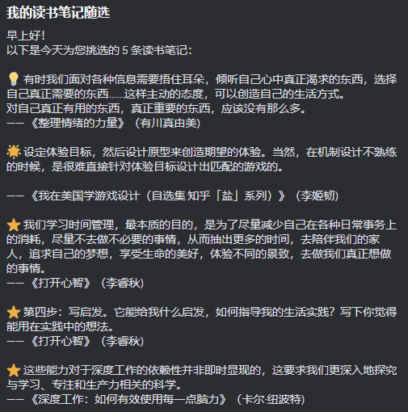

# weread2discord

Send 5 random highlights from your WeRead (微信读书) library to Discord every day.

Inspired by **Readwise**'s daily email review, rebuilt for WeRead + Discord.
Runs entirely on GitHub Actions — no server required.

[中文说明 ↓](#从微信读书中抽划线或笔记发送到-discord)

---

## What it does

Every day (via GitHub Actions), this script picks 5 random highlights or notes
from your WeRead account and posts them to a Discord channel through a webhook.
A small, dependency-light way to keep what you read coming back to you.

- **Language:** Python
- **Dependencies:** `requests` only
- **License:** MIT
- **Setup:** 4 steps, no programming required (see below)

## Preview

## Setup (English)

1. **Fork this repository.**
2. **Get your WeRead API key**
   - Open <https://weread.qq.com/r/weread-skills> (or the "WeRead Skill" page in the WeRead app)
   - Log in and generate an API key (starts with `wrk-`; long-lived, no cookie rotation needed)
3. **Get your Discord webhook URL**
   - Open the Discord server/channel settings (requires admin or owner)
   - Go to **Integrations → Webhooks → New Webhook → Copy Webhook URL**
4. **Add the secrets to your fork**
   - In your fork: **Settings → Secrets and variables → Actions → New repository secret**
   - Add: `WEREAD_API_KEY` and `DISCORD_WEBHOOK_URL`

The scheduled workflow will then run daily. You can also trigger it manually
from the **Actions** tab.

## Acknowledgements

- Idea inspired by **Readwise**'s daily email review.
- Originally adapted from <https://github.com/malinkang/weread2notion>

---

# 从微信读书中抽划线或笔记发送到 Discord

每天从微信读书中抽出 5 条划线或笔记，通过 Webhook 发送到 Discord 中。

## 感谢

灵感出自 **Readwise** 的**每日邮件回顾**。

代码改自 [https://github.com/malinkang/weread2notion](https://github.com/malinkang/weread2notion)

## 使用

1. Fork 这个工程
2. 获取微信读书的 API Key
    * 打开 [https://weread.qq.com/r/weread-skills](https://weread.qq.com/r/weread-skills)（或在微信读书 App 内的「微信读书 Skill」页面）
    * 登录微信读书账号，生成并复制 API Key（`wrk-` 开头，长期有效，无需像 Cookie 一样反复更新）
3. 获取 Discord 的 Webhook URL
    * 打开要发送消息的 Discord 服务器或频道（需要管理员或拥有者权限）
    * 打开服务器设置或频道设置
    * 在服务器或频道设置页面中，依次点「整合」->「Webhook」->「新 Webhook」->「新创建出来的 Webhook」->「复制 Webhook URL」
4. 在 GitHub 的 Secrets 中添加变量
    * 打开第一步 Fork 的工程，点击「Settings」->「Secrets and variables」->「New repository secret」
    * 添加以下变量
        * WEREAD_API_KEY
        * DISCORD_WEBHOOK_URL

## 预览图

---

